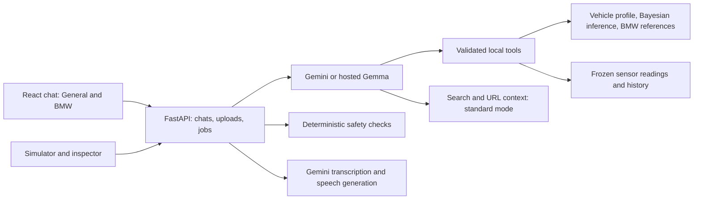

# AutoSage

**Understand your car before you repair it.**

An AI car companion that investigates reported symptoms, explains vehicle readings, and helps prepare a mechanic handoff. AutoSage combines Gemini tool calling, multimodal input, BMW reference material, local Bayesian inference, and deterministic safety checks in a conversational workspace.

**Hackathon prototype:** vehicle readings are simulated and the diagnostic model uses synthetic training data. AutoSage does not connect to a real car or certify that a vehicle is safe to drive.

[Quick start](#quick-start) · [Demo](#try-the-demo) · [Voice](#speech-input-and-spoken-answers) · [Architecture](#architecture) · [Verification](#verification) · [Limitations](#data-and-limitations)

## What it does

| Capability | How it works |
| --- | --- |
| Guided investigation | Keeps conversation context, gathers evidence, and asks one focused follow-up at a time. |
| Multimodal input | Accepts text, photos, audio, and video, with recording, previews, and playback. |
| Speech input and output | Converts speech into an editable draft and automatically reads a short summary of new answers. |
| Automatic sensor review | Reviews all 17 simulated channels and sampled history from a frozen snapshot. |
| BMW workspace | Adds local knowledge and recall metadata for the 2019–2024 BMW 330i G20 petrol. |
| Grounded assistance | Uses Gemini Google Search and URL context, with linked sources when returned. |
| Diagnostic guidance | Runs local Bayesian inference across tires, brakes, cooling, starting/charging, and engine running. |
| Safety and handoff | Escalates critical reported symptoms and creates a copyable mechanic report when requested. |
| Investigation visibility | Shows execution events, available probability charts, and sources; an operator inspector exposes technical details. |
| Remote-breakdown simulation | Switches to hosted Gemma and blocks web tools while retaining access to the Google API. |

## Quick start

Requirements: **Python 3.11+**, **Node.js 20.19+ or 22.12+**, npm, and a Gemini API key with access to the configured diagnostic and speech models. Hosted model and speech calls require internet access and may incur charges.

These commands use **PowerShell**, starting in the repository root.

### 1. Install the backend

```powershell
python -m venv .venv
.venv/Scripts/python -m pip install -r backend/requirements.txt
if (-not (Test-Path .env)) { Copy-Item .env.example .env }
```

Set your key in the root `.env`:

```dotenv
GEMINI_API_KEY=your_google_ai_studio_key
GEMINI_MODEL=gemini-4-carbon
```

Keep `.env` private; it is Git-ignored. Model names are repository defaults and require account access. Missing credentials, unavailable models, and quota errors produce explicit failures. Existing environment variables take precedence over `.env`; restart the backend after configuration changes.

### 2. Start the API

```powershell
.venv/Scripts/python -m uvicorn backend.app.main:app --host 127.0.0.1 --port 8000
```

Use **one backend worker**. Chats, jobs, attachments, and simulator state live in that process's memory and clear on restart.

### 3. Start the frontend

In a second terminal:

```powershell
cd frontend
npm ci
npm run dev
```

Open [AutoSage](http://127.0.0.1:5173/). Keep both servers running. Vite proxies `/api` to the backend; the frontend contains no Gemini key.

On macOS/Linux, use `.venv/bin/python` instead of `.venv/Scripts/python` and copy `.env.example` to `.env` only if it does not exist. Microphone and camera capture require localhost or HTTPS, browser permission, and supported recording formats.

## Try the demo

| Workspace | Purpose |
| --- | --- |
| [General chat](http://127.0.0.1:5173/) | Investigate symptoms for a vehicle described in the conversation. |
| [BMW 330i G20](http://127.0.0.1:5173/bmw) | Use the BMW-specific workspace and bundled reference tools. |
| [Simulator](http://127.0.0.1:5173/simulator) | Choose scenarios, edit readings and history, and inspect investigations. |

1. Open the simulator in another tab and select **Tire pressure loss**.
2. Open General or BMW chat and select **Check what’s wrong with my car**. The backend reads available channels and history before requesting the model's explanation.
3. Expand **Investigation details** to inspect actual execution events, available probability charts, and sources. Answer the follow-up from observations you already have.
4. Try **Voice** to dictate a message, or attach a photo, sound recording, or video. Ask for a mechanic handoff when ready.
5. In a fresh chat, describe **“My brake pedal is soft and the brakes are not stopping the car properly.”** The reported symptom triggers immediate stop-driving guidance without waiting for a model call.

The [two-minute demo script](DEMO_SCRIPT.md) provides narration, prompts, and rehearsal checks. Mute spoken answers when recording your own narration.

General and BMW chats keep separate conversation lists and share the simulator. BMW mode supplies make/model context, but exact year, market, equipment, and VIN remain unconfirmed. It excludes the 330e plug-in hybrid.

## Speech input and spoken answers

- **Dictate:** select **Voice**, start recording while safely parked, then stop. Gemini appends the transcript to your existing draft. Review or edit it before selecting **Send**; dictation never submits automatically.
- **Attach audio evidence:** use **Attach → Record audio** for a voice note or vehicle sound instead of dictation.
- **Listen:** spoken answers start enabled. Each new completed answer in the active chat gets a short spoken summary with its follow-up question. Deterministic safety warnings are spoken verbatim.
- **Control playback:** use **Mute spoken answers**, **Play answer**, **Stop speaking**, and the expandable **Spoken summary**. The mute preference is saved in your browser. If autoplay is blocked, tap **Play answer**.
- **Recover:** transcription failures preserve your draft and recording for retry until canceled or you leave the chat. Speech-generation errors leave the written answer available. Switching chats, starting capture, or sending another message stops playback; history never autoplays.

Dictation supports recordings up to **two minutes / 25 MB**. Speech uses the backend Gemini key with separate speech models. Summaries use the investigation's diagnostic model without tools; generated audio is cached in memory for up to 64 readouts. This is turn-based speech, without continuous listening or live interruption.

## Model modes

On the simulator, **Block internet access (remote breakdown)** changes the model and web-tool policy for new investigations in both chat workspaces.

| Mode | Model | Web tools | Google API connection |
| --- | --- | --- | --- |
| Standard | Configured `GEMINI_MODEL` | Google Search and URL context available | Required |
| Remote breakdown | `gemma-4-26b-a4b-it` | Blocked; bundled references and local tools remain available | Required |
| Actual internet outage | Hosted models and speech unavailable | Unavailable | Cannot reach the provider |

This toggle simulates restricted web access. It does not change OS networking or run a local Gemma model. Provider failures do not automatically activate it, and rejected Gemma access does not silently select another model. Running investigations and retries retain their original policy; changing scenarios or resetting readings preserves the toggle.

## Architecture



**Stack:** React 19, TypeScript, Vite, Tailwind CSS, and Lucide; FastAPI, Pydantic, the Google GenAI SDK, Pillow, and bundled FFmpeg. Tests use pytest and Playwright.

### Evidence and diagnostic behavior

- The simulator exposes **17 channels across five domains**, with five prepared scenarios: tire pressure loss, low brake fluid, temperature rise, battery voltage drop, and unstable idle. Missing channels remain unknown; engine-off values alone do not establish a fault.
- Every accepted investigation freezes its readings and history. Later edits affect the next request; retries and historical evidence retain their original snapshot. Stale simulator writes are rejected using revision checks.
- The local naive Bayes model has **18 categories**, including an other/unmodeled category in each domain. It uses validated evidence, tracks unknowns and conflicts, and selects follow-up questions by information gain. Its 10,000 training and 2,000 validation examples per domain are synthetic; displayed probabilities are not validated real-world diagnostic confidence.
- BMW mode adds `search_bmw_knowledge` and `check_bmw_recalls`, backed by 22 authored knowledge cards, domain notes, a sensor catalogue, and selected US 2021 recall metadata. Recall applicability is always VIN-unverified. See the [reference pack](car_docs/README.md) and its [local browser](car_docs/START_HERE.html).
- Investigations are bounded to six model turns, twelve custom tool invocations, and 180 seconds, with bounded cleanup afterward. The activity panel shows actual execution events rather than hidden model reasoning.

The fitted model is included; training never runs during conversations. To explicitly regenerate its synthetic datasets and model artifact, run `.venv/Scripts/python -m backend.train_bayes` from the root. This rewrites files in `backend/data/`.

For route schemas, open the [local API documentation](http://127.0.0.1:8000/docs) while the backend is running. Main endpoints cover incidents/messages, speech transcription/readout, reports, attachments, and the shared simulator. Simulator writes require the current revision in `If-Match`; browser writes are restricted to localhost/127.0.0.1 on ports 5173 and 8000.

## Configuration

Backend settings belong in the root `.env`:

| Variable | Default | Purpose |
| --- | --- | --- |
| `GEMINI_API_KEY` | Empty | Backend credentials for hosted model and speech calls. |
| `GEMINI_MODEL` | `gemini-4-carbon` | Standard investigation model; restricted mode pins Gemma. |
| `GEMINI_STT_MODEL` | `gemini-3.5-transcribe` | Dictation model. |
| `GEMINI_TTS_MODEL` | `gemini-3.8-flash-tts` | Spoken-answer audio model. |
| `GEMINI_TTS_VOICE` | `Kore` | Generated voice. |

For frontend development, `VITE_API_TARGET` can override the default backend target, `http://127.0.0.1:8000`. Browser tests accept `PLAYWRIGHT_BASE_URL`, defaulting to `http://127.0.0.1:5173`. Changing the proxy target does not expand accepted browser origins.

## Verification

From the repository root:

```powershell
# Provider-injected backend tests; no live Google calls
.venv/Scripts/python -m pytest backend/tests -q

# TypeScript checks and production build
npm --prefix frontend run build
```

For browser tests, keep **FastAPI and Vite running** at the documented addresses, then use a separate terminal:

```powershell
cd frontend
npx playwright install chromium
npm run test:e2e
```

These tests cover chat, recording, speech, retries, citations, safety, Bayesian inference, BMW tools, simulator revisions, and responsive layouts. Browser tests use provider fixtures, simulated devices, and the local simulator API without provider charges. They do not establish real-world diagnostic accuracy or physical-device compatibility.

The following **opt-in, billable live rehearsals** send synthetic prompts/media to Google:

```powershell
.venv/Scripts/python -m backend.tests.live_smoke
.venv/Scripts/python -m backend.tests.live_followup
.venv/Scripts/python -m backend.tests.live_sensors
```

They exercise multimodal/search/tool calls, multi-turn follow-ups, and sensor investigations respectively. They are separate from the default pytest suite.

## Data and limitations

- **Local prototype:** no database, authentication, production hosting configuration, or multiworker coordination. Browser reloads retain state only while the same backend process remains running. The browser-origin check is not authentication.
- **Vehicle scope:** no hardware connection, ECU writes, DTC clearing, live VIN recall verification, or certification of roadworthiness. The configured 2.3-bar demo reference is not a manufacturer specification. Safety rules are conservative examples, not a comprehensive assessment.
- **Connectivity:** hosted Gemini/Gemma and speech require internet access. Local rules, Bayesian inference, and bundled reference retrieval can run offline, but do not replace the hosted conversation.
- **Media limits:** five attachments per message, 25 MB per file, 50 MB combined, and 10,000 text characters. Audio capture stops at two minutes; video at one minute. Images are decoded to JPEG, audio to mono WAV, and video to MP4.
- **Google processing:** prompts, media, speech content, and search queries are sent to Google. Temporary provider uploads are deleted on a best-effort basis; cleanup failures may leave files. Deletion does not clear provider interaction history. Prior media may be reuploaded on follow-up turns, increasing costs.
- **Reference rights:** full BMW/third-party manuals are not bundled. Most original source links need internet access and appropriate rights. Bundled recall metadata is a snapshot and is not a VIN-specific determination.

Future work includes read-only vehicle connectivity, local Gemma inference, durable storage, authentication, and broader rights-cleared reference material.

## Repository guide

| Path | Contents |
| --- | --- |
| [`frontend/`](frontend/) | Customer workspaces, simulator/inspector, capture, playback, and browser tests. |
| [`backend/app/`](backend/app/) | API, providers, agent tools, safety, evidence, inference, and speech. |
| [`backend/data/`](backend/data/) | Fitted model, synthetic datasets, and fictional demo handbook. |
| [`backend/tests/`](backend/tests/) | Backend tests, provider fakes, and opt-in live rehearsals. |
| [`car_docs/`](car_docs/README.md) | BMW reference pack, source catalogue, authored notes, and local tools. |
| [`DEMO_SCRIPT.md`](DEMO_SCRIPT.md) | Two-minute narration and rehearsal instructions. |
| [`UI/`](UI/PLAN.md) | Original interface concepts and implementation history. |
| [`PROJECT_PLAN.md`](PROJECT_PLAN.md) | Historical specification and roadmap; this README describes the current implementation. |

## License

Application code uses the [MIT License](LICENSE). Third-party materials retain their own rights; see the BMW pack's [legal and provenance notes](car_docs/LEGAL_AND_PROVENANCE.md).
