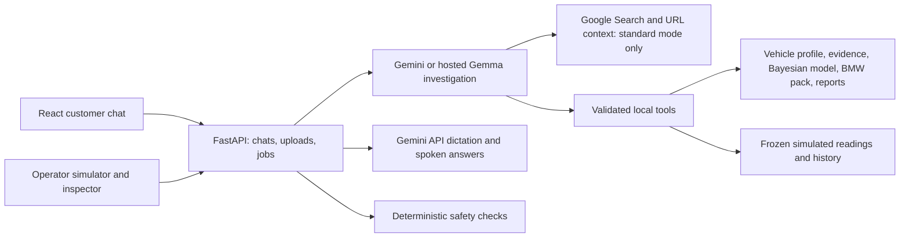

# AutoSage

**An AI car companion for investigating symptoms, understanding vehicle readings, and preparing a mechanic handoff.**

AutoSage combines a multimodal AI conversation with validated tools, local Bayesian inference, reference material, and deterministic safety checks. Drivers can describe a warning, share a photo or recording, or select **Check what’s wrong with my car** for an automatic review of available readings. Standard investigations use Gemini; the remote-breakdown mode switches to hosted Gemma with web tools blocked. Gemini API speech-to-text and text-to-speech provide dictated messages and spoken answers. The assistant gathers evidence, asks one focused follow-up at a time, and explains findings and a safe next action.

The application includes a general diagnostic workspace, a dedicated **BMW 330i G20** workspace, and a separate operator simulator. It is a local hackathon prototype: vehicle telemetry is simulated, and diagnostic categories and probabilities come from synthetic training data. It does not connect to a real car or certify that a vehicle is safe to drive.

## Features

| Capability | What is available |
| --- | --- |
| Multimodal conversations | Text, uploaded images/audio/video, microphone recording, camera video recording, attachment previews, and audio/video playback. |
| Guided investigation | Conversation context across turns, confirmed vehicle details, one targeted follow-up at a time, and explicit uncertainty when evidence is insufficient. |
| Check what’s wrong with my car | One-click review of all 17 simulated channels and sampled history from one snapshot, followed by findings and a safe next action from the selected Gemini/Gemma model. |
| Speech-to-text | Gemini API dictation converts a voice recording into editable message text for review before sending; audio attachments remain available for sound analysis. |
| Text-to-speech | Gemini API speech generation reads a concise summary of a completed answer, retaining safety guidance, uncertainty, and its follow-up question. |
| Grounded answers | Gemini Google Search and URL context, linked citations, and Google Search suggestions when returned by the provider. |
| BMW-specific assistance | Separate BMW chats, starter prompts, local knowledge retrieval, recall metadata, and channel-specific OBD/hardware caveats for the G20 330i petrol. |
| Bayesian guidance | Local inference across tires, brakes, cooling, starting/charging, and engine running; 18 categories including an other/unmodeled category in each domain. |
| Safety escalation | Immediate deterministic checks for critical reported symptoms, additional checks on registered media observations, and a persistent stop-driving panel for escalated incidents. |
| Mechanic handoff | A copyable report when generated, separating reported symptoms, unconfirmed assessments, media observations, sources, and uncertainties; richer provenance is available through the API. |
| Investigation visibility | A collapsible chat panel with actual execution events, domain probability charts, and sources; a separate operator inspector exposes raw tools, evidence, revisions, and provider details. |
| Demo controls | Shared simulator with five scenarios, editable readings, availability controls, presets, custom trends, history charts, and timestamped tables. |
| Offline-mode simulation / Gemma switch | The remote-breakdown toggle selects **Gemma 4 26B through the Gemini API** and blocks web search/external-page retrieval; sensor tools and bundled references remain available. Hosted inference still needs an API connection. |
| Recoverable processing | Background investigations with polled progress, preserved drafts after submission failures, request-ID deduplication, and retry of the latest failed investigation. |
| Responsive interface | Desktop recent-chat navigation, mobile navigation drawer, recording/review controls, and reduced-motion support for the activity spinner. |

## Workspaces

| Page | Purpose |
| --- | --- |
| [`/`](http://127.0.0.1:5173/) | General diagnostic conversations. Vehicle make, model, and year can be supplied in chat. |
| [`/bmw`](http://127.0.0.1:5173/bmw) | BMW 330i (G20), 2019–2024 petrol, B46TU/B48TU context, with dedicated knowledge and recall tools. |
| [`/simulator`](http://127.0.0.1:5173/simulator) | Operator controls for shared simulated readings and inspection of individual investigations. Open alongside the customer chat. |

The General and BMW tabs retain separate chat lists and selections. Both use the same global simulator for their next investigation. `/bmw-330i` and `/bmw-330i-g20` also open the BMW workspace. The BMW preset supplies make/model context; it does not confirm an exact model year, market, equipment, or VIN, and excludes the 330e plug-in hybrid.

## Local setup

### Requirements

- Python **3.11+**.
- Node.js **20.19+ or 22.12+**, with npm, for the Vite 7 frontend.
- A Gemini API key and account access to a compatible model with the required multimodal, search, URL-context, and function-calling capabilities. The Gemma mode and speech features require access to their respective hosted models as well.
- Internet access for hosted Gemini/Gemma investigations and speech requests. Local BMW reference search and Bayesian inference do not require network access.

The following commands use **PowerShell** from the repository root.

### 1. Install the backend and configure Gemini

```powershell
python -m venv .venv
.venv/Scripts/python -m pip install -r backend/requirements.txt
if (-not (Test-Path .env)) { Copy-Item .env.example .env }
```

Edit the root `.env`:

```dotenv
GEMINI_API_KEY=your_google_ai_studio_key
GEMINI_MODEL=gemini-4-carbon
# Optional speech-model overrides; these are the current backend defaults
GEMINI_STT_MODEL=gemini-3.5-transcribe
GEMINI_TTS_MODEL=gemini-3.8-flash-tts
GEMINI_TTS_VOICE=Kore
```

`gemini-4-carbon` is the repository's configured default, not a guarantee of availability for your account. Set `GEMINI_MODEL` to a compatible model you can access if needed. Speech model identifiers above are also repository defaults and require account access. Missing credentials, rejected access, quota limits, and unsupported provider responses produce explicit failures. The Gemma switch is selected through the remote-breakdown toggle; there is no automatic fallback on a Gemini error or actual network loss. Hosted model, Search, transcription, and speech-generation calls may incur charges.

Keep the API key in the backend-only, Git-ignored `.env`. Existing environment variables take precedence over `.env` values. Restart the backend after changing configuration.

### 2. Start the API

```powershell
.venv/Scripts/python -m uvicorn backend.app.main:app --host 127.0.0.1 --port 8000
```

Use **one backend worker**: chats, background jobs, attachments, and simulator state are held in that process's memory.

### 3. Start the frontend

In a second terminal, from the repository root:

```powershell
cd frontend
npm ci
npm run dev
```

Open [AutoSage](http://127.0.0.1:5173/). Keep both servers running. Vite proxies `/api` to `http://127.0.0.1:8000`; the frontend bundle contains no Gemini key. On macOS/Linux, use `.venv/bin/python` in place of `.venv/Scripts/python` and copy `.env.example` to `.env` only if it does not already exist.

### Configuration reference

| Variable | Default | Purpose |
| --- | --- | --- |
| `GEMINI_API_KEY` | Empty | Backend Gemini credentials; required for live investigations. |
| `GEMINI_MODEL` | `gemini-4-carbon` | Standard-mode model selection. Restricted mode always pins `gemma-4-26b-a4b-it`. |
| `GEMINI_STT_MODEL` | `gemini-3.5-transcribe` | Gemini API speech-to-text model for dictation. |
| `GEMINI_TTS_MODEL` | `gemini-3.8-flash-tts` | Gemini API model for spoken-answer audio. |
| `GEMINI_TTS_VOICE` | `Kore` | Voice used for generated speech. |
| `VITE_API_TARGET` | `http://127.0.0.1:8000` | Optional Vite development proxy target; set in the frontend process environment. |
| `PLAYWRIGHT_BASE_URL` | `http://127.0.0.1:5173` | Optional frontend URL for browser tests. |

The backend accepts browser writes from localhost/127.0.0.1 on ports **5173 and 8000**. Keep these ports for the documented setup; changing the proxy target alone does not expand the accepted browser origins.

## Try an investigation

1. Open General or BMW mode and start a conversation, or use the automatic sensor-review button to create one. BMW mode also offers example prompts.
2. Describe an observed symptom, such as **“My yellow TPMS warning is showing.”** Attach a dashboard photo, upload a recording, or record audio/video if useful. Text-only, media-only, and mixed submissions are supported.
3. The saved message appears immediately while the investigation processes. Expand **Investigation details** to see execution events; after completion it also contains available probability charts and sources.
4. Answer the single follow-up from observations you already have. **“I don't know”** leaves evidence unknown; **“Stop asking questions”** ends Bayesian questioning. Vehicle details can be confirmed in the conversation when needed.
5. Ask for a mechanic handoff when you want a factual summary to copy. A failed latest investigation can be retried with its saved message, attachments, and original sensor snapshot.

For the sensor demo, open `/simulator`, enable readings or choose a scenario, then select **Check what’s wrong with my car** in either chat mode. See the automatic-check and voice workflows below.

Critical reported symptoms can trigger guidance immediately without a Gemini call. Safety escalation remains active for that incident and overrides further diagnostic questioning. These conservative demonstration rules are not a comprehensive automotive safety assessment; absence of a trigger is not permission to drive.

## Check what’s wrong with my car

The main action in both **General** and **BMW 330i G20** mode starts a sensor-based investigation without requiring a typed symptom or a vehicle-details form first. It creates a conversation if needed and uses the currently selected model: Gemini in standard mode or Gemma in remote-breakdown mode.

1. Open `/simulator` in another tab and enable readings or choose a prepared scenario, such as **Tire pressure loss**.
2. Return to either chat workspace and select **Check what’s wrong with my car**.
3. The backend freezes the simulator state, discovers all 17 channels, and reads current values plus sampled history before requesting the model's explanation.
4. Review noteworthy readings and trends, missing information, and the next safe action. Expand **Investigation details** for events and available Bayesian charts, or use the operator inspector for raw readings and provenance.

Disabled readings produce an immediate unavailable message without a model call. Missing channels stay unknown. Engine-off readings such as zero RPM, airflow, or fuel pressure do not independently establish a fault. Edits made during processing affect the next check; retrying a failed check retains its original readings and connectivity setting. All readings currently come from the simulator, and the review cannot confirm mechanical faults or roadworthiness.

## Voice: speech-to-text and text-to-speech

The speech workflow uses the **Gemini API**, the existing backend-only `GEMINI_API_KEY`, and the separate speech-model settings above. In either General or BMW chat, dictate and review a message, send it, then hear a short spoken answer. This is turn-based speech, separate from attaching a voice note or engine-sound clip for multimodal investigation.

### Speech-to-text: dictate a message

Select **Voice**, start recording while safely parked, then stop to transcribe. The returned text is appended to your editable message draft so you can correct it and explicitly send it. Transcription never submits an investigation. Failures preserve both the draft and recording for **Retry transcription** until you cancel or leave the chat. **Attach → Record audio** still adds audio evidence, including engine sounds, without dictating text.

The backend accepts audio recordings up to **two minutes** and **25 MB**, normalizes them to WAV, and requests a verbatim transcript through the configured speech-to-text model. Empty transcripts and text longer than **10,000 characters** return an error rather than an invented message. Provider uploads are deleted on a best-effort basis after transcription.

### Text-to-speech: listen to an answer

Spoken answers start **enabled by default** for newly completed answers in the active chat. The backend targets a 60-word summary in the answer's language, preserving uncertainty, warnings, and the next safe action, then appends the follow-up question once. Safety-rule responses are spoken verbatim. **Mute spoken answers** saves your preference in this browser. **Play answer**, **Stop speaking**, and the expandable **Spoken summary** provide manual controls. If autoplay is blocked, tap **Play answer**. History never autoplays. Starting microphone capture, submitting another message, or switching chats stops playback. Speech does not replace the written answer or its source links.

Spoken summaries use the answer's original Gemini/Gemma model without tools, while audio synthesis uses `GEMINI_TTS_MODEL` and `GEMINI_TTS_VOICE`. Successful audio is cached temporarily in backend memory (up to 64 readouts) to reuse playback requests. Eviction can expire older audio URLs. Speech failures are separate from investigation results, so the written answer remains available and speech can be retried independently.

Both directions make hosted Google API calls and may incur additional charges. Temporary transcription uploads are deleted on a best-effort basis; cleanup failures are logged and may leave a provider file. Deletion does not clear provider interaction history. Speech still requires API connectivity in Gemma remote-breakdown mode; no local speech engine is included. Microphone permission, localhost/HTTPS, and compatible browser recording/playback support are required. Actual device quality and browser autoplay policies require device testing. Continuous listening and live interruption are not included.

## Shared vehicle simulator

The simulator exposes **17 channels in five domains**:

| Domain | Channels |
| --- | --- |
| Tires | Front-left, front-right, rear-left, and rear-right pressure. |
| Brakes | Brake-fluid level and brake pressure. |
| Cooling | Coolant temperature, coolant level, cooling-fan RPM, and vehicle speed. |
| Starting and charging | Battery voltage, cranking RPM, and starter current. |
| Engine running | Engine RPM, misfires in 60 seconds, fuel pressure, and mass airflow. |

Five prepared scenarios demonstrate **tire pressure loss**, **low brake fluid**, **temperature rise**, **battery voltage drop**, and **unstable idle**. Each scenario enables simulation and leaves unrelated channels unavailable. Operators can also edit values, mark channels unavailable, restore individual baselines, apply compatible presets, or create trends lasting **1–10,080 minutes**. Charts and tables preserve missing readings. Reset restores illustrative parked, engine-off baselines and preserves the enable switch.

Values are stable between edits: there is no background drift, hardware connection, or actual OBD measurement. Baselines and scenario values are fictional, not manufacturer specifications or verified healthy readings.

Every accepted investigation freezes the current revision. Subsequent edits affect the next accepted message across chats; running investigations, retries, and historical evidence retain their original snapshot. Operator writes use `If-Match` revisions: stale edits are rejected and require an explicit reload, while unsaved drafts remain visible. State survives browser reloads and clears when the backend restarts.

## Offline-mode simulation and Gemma fallback

On `/simulator`, select **Block internet access (remote breakdown)**. This setting applies to General and BMW chats independently of whether simulated sensor data is enabled. The next investigation uses **Gemma 4 26B** (`gemma-4-26b-a4b-it`) hosted through the same **Gemini API** and `GEMINI_API_KEY`. The exact hosted model identifier and function-calling API follow [Google's Gemma API documentation](https://ai.google.dev/gemma/docs/core/gemma_on_gemini_api).

| Mode | Investigation model | Web access | API connection |
| --- | --- | --- | --- |
| Standard | Configured `GEMINI_MODEL` | Google Search and URL context available | Required |
| Remote breakdown / simulated offline | Pinned `gemma-4-26b-a4b-it` | Web tools blocked; bundled references remain available | Required |
| Actual internet outage | Hosted models and speech unavailable | Unavailable | Cannot reach the provider; local rules/inference are not a replacement AI conversation |

The application removes Google Search and URL-context tools from the request and rejects `web_search` and other web operations at dispatch. Sensor reads/history, local Bayesian inference, and bundled BMW knowledge/recall metadata remain available. Saved reference URLs identify bundled sources; they do not mean a live website or current VIN-specific recall was checked. The chat shows the restricted mode and attributes each Gemma response. There is no fallback to another model if Gemma access fails.

This is an **application-level connectivity simulation**, not a computer firewall or a fully offline system: the Gemini API, speech requests, and media-upload connection remain allowed. Actual loss of internet prevents hosted Gemma responses. The toggle does not change OS networking or install/download local models, and Gemini failures do not automatically activate it. New messages freeze this setting with the sensor revision; running investigations and retries keep their original policy. Resetting readings or choosing a scenario preserves the connectivity toggle; turning the toggle off restores the standard model and web tools for new messages.

## BMW knowledge and recall tools

BMW mode adds two validated tools backed by [`car_docs/`](car_docs/README.md):

- **`search_bmw_knowledge`** searches authored local cards and notes by query terms and optional domain. It returns applicable excerpts, caveats, source IDs, and reference links. This is local keyword-based retrieval, without an embedding service or vector database.
- **`check_bmw_recalls`** searches bundled campaign metadata and returns scope notes and official lookup references. It always reports that VIN applicability is unverified. It is not a live recall database or a complete recall search for every model year and market.

The pack contains 22 knowledge cards, a 17-channel sensor catalogue, source references, domain notes, synthetic examples, and selected US 2021 330i recall metadata. Sensor tools in BMW mode include hardware and retrieval caveats: a channel's presence in the simulator does not mean that a real vehicle exposes it through generic OBD.

The authored reference pack can be browsed locally through [`car_docs/START_HERE.html`](car_docs/START_HERE.html). Original linked manuals generally require internet access and appropriate access rights; full BMW/third-party repair manuals are not bundled. Local retrieval works offline, but the conversational assistant still requires hosted Gemini/Gemma API access. Read the pack's [provenance and reproduction notes](car_docs/LEGAL_AND_PROVENANCE.md) before reusing source material.

## Bayesian guidance

The backend runs a saved naive Bayes model independently of Gemini. The language model cannot invent its percentages or supply its own evidence directly to the classifier.

| Domain | Modeled categories, plus other/unmodeled |
| --- | --- |
| Tires | Pressure loss; TPMS monitoring issue. |
| Brakes | Hydraulic concern; indicator issue. |
| Cooling | Coolant loss; circulation problem; fan/control issue. |
| Starting and charging | Low battery charge; starter circuit issue; charging system issue. |
| Engine running | Ignition/misfire concern; air/fuel delivery concern; sensor/control concern. |

Conservative English symptom patterns and validated, source-linked observations feed inference. Short yes/no answers apply only to the pending question. Missing, ambiguous, hypothetical, or unconfirmed observations stay unknown; repeated evidence is counted once and conflicts require clarification. Simulated tire-pressure evidence additionally requires a valid demo reference and confirmed parked/cold-tire conditions. The fictional handbook's **2.3-bar** reference is not a real vehicle specification.

Questions are selected by expected information gain above **0.01 bits**, with conflicts prioritized. Questioning stops when no useful unanswered question remains, the user declines/stops, or safety escalates. An other/unmodeled leader, top probability below **0.60**, margin below **0.15**, unspecified context, or unresolved conflict produces an inconclusive result. Missing/invalid model artifacts return `model_error` without fabricated probabilities.

**Synthetic training only:** `autosage-trained-v2` was fitted with Laplace smoothing from **10,000 generated examples per domain**, with **2,000 separately generated validation examples per domain**. The generator uses hand-authored toy assumptions, not automotive statistics. Agreement with its synthetic labels does not establish real diagnostic accuracy or calibrated confidence. Domains are independent, and charts show category estimates rather than individual sensor fault probabilities.

The checked-in artifact is ready to use. To explicitly reproduce training from the repository root, without internet or API calls:

```powershell
.venv/Scripts/python -m backend.train_bayes
```

This rewrites the training/validation JSONL datasets and `backend/data/bayes_model.json`, including counts, seeds, SHA-256 hashes, and model/generator versions. Training never runs during conversations. Local results and safety guidance can remain available when Gemini fails, alongside the explicit provider error and retry state; this does not constitute a successful offline AI conversation.

## Architecture and agent tools



The frontend uses **React 19, TypeScript, Vite, Tailwind CSS, and Lucide icons**. The backend uses **FastAPI, Pydantic, the Google GenAI SDK, Pillow, and bundled FFmpeg via `imageio-ffmpeg`**. Playwright covers browser interactions; pytest covers backend behavior.

The general tool set includes `get_vehicle_profile`, `update_vehicle_profile`, `record_observations`, `classify_diagnosis`, `list_available_sensors`, `read_vehicle_sensors`, `read_sensor_history`, and `create_mechanic_report`, alongside provider Search and URL context in standard mode. BMW mode adds the two reference tools above. Sensor tools are available only when simulation is enabled. The automatic review invokes discovery, current readings, and sampled history in the backend before requesting the selected model's summary. Dictation and spoken-answer requests use separate speech endpoints.

Tool arguments are validated, and evidence must reference the incident's own messages/processed attachments. Web references are not treated as vehicle measurements. The backend ensures local classification runs when applicable even if Gemini omits it. Events identify backend versus model execution and expose tool activity rather than hidden model reasoning. Each investigation is bounded to **six model turns, twelve custom tool invocations, and 180 seconds**, with bounded cleanup afterward.

## Media, privacy, and storage

- **Limits:** 10,000 text characters, five attachments per message, **25 MB per file**, and **50 MB combined**. Audio capture stops after two minutes and video after one minute; file limits still apply.
- **Processing:** Images are decoded to JPEG, with a 20-million-pixel limit; animated GIFs use their first frame. Audio becomes mono WAV, and video becomes MP4 through bundled FFmpeg. Invalid or unsupported media produces an error.
- **Provider uploads:** Actual media is sent through Gemini's Files API for analysis. Cleanup attempts to delete provider files after success or failure; cleanup failures are recorded in activity. Local originals remain available for playback until restart.
- **Follow-up context:** Prior attachments are reuploaded when rebuilding later turns, increasing processing and token costs for long media conversations. Provider continuations use stored interaction IDs within an investigation.
- **External services:** Prompts, uploaded media, and search queries are sent to Google. Deleting Files API uploads does not delete stored Interactions history or change Google's service data policies.
- **Speech data:** Dictation sends recorded speech to Google for transcription. Spoken-answer generation sends the answer/summary for hosted summarization and audio synthesis. Generated audio and cached playback references are temporary and may also be evicted from the in-memory cache before restart.
- **Recording:** Camera/microphone capture requires localhost or HTTPS, browser permission, and supported codecs. Uploads remain available when recording is denied or unsupported. Physical devices and cross-browser behavior need separate testing.
- **Temporary storage:** Chats, reports, request IDs, jobs, media, and simulator state live in backend memory. Restarting clears them. Browser reloads preserve them only while the same backend process remains running.

## API overview

| Method | Route | Purpose |
| --- | --- | --- |
| `GET` | `/api/health` | Provider/model, configuration status, input capabilities, and whether this process completed an investigation with the configured real provider. Never returns credentials. |
| `GET` / `POST` | `/api/incidents` | List or create chats. Creation accepts optional `mode` (`general` or `bmw_g20`) and `vehicle: {make, model, year}`; listing supports a `mode` filter. |
| `GET` | `/api/incidents/{id}` | Conversation, attachments, progress/errors, citations, and execution events. |
| `PATCH` | `/api/incidents/{id}/vehicle` | Update vehicle details while no investigation is processing. |
| `POST` | `/api/incidents/{id}/messages` | Multipart `request_id`, optional `text`, repeated `files`, and optional `sensor_check`; returns `202`. Text or an attachment is required. |
| `POST` | `/api/incidents/{id}/messages/{message_id}/retry` | Retry the latest failed assistant investigation; returns `202`. |
| `POST` | `/api/speech/transcriptions` | Speech integration: multipart audio `file`; returns editable transcript text as `{ "text": "..." }`. Does not submit a chat message. |
| `POST` | `/api/incidents/{id}/messages/{message_id}/speech` | Speech integration: summarize a completed assistant answer and synthesize audio; returns `text`, `audio_url`, and `mime_type`. |
| `GET` | `/api/incidents/{id}/report` | Mechanic handoff with evidence, inference history, provenance, and uncertainties. |
| `GET` | `/api/incidents/{id}/inspection` | Operator evidence, diagnostic state, incident, report, and provider status. |
| `GET` | `/api/attachments/{id}` | Temporary original attachment for previews/playback. |
| `GET` / `PATCH` | `/api/simulator` | Read shared simulation or change its enabled state. |
| `PATCH` | `/api/simulator/connectivity` | Set `{ "internet_blocked": true }` to pin hosted Gemma 4 26B and block web tools for new investigations; `false` restores standard mode. |
| `PATCH` | `/api/simulator/sensors/{name}` | Change a channel using `value`, `unavailable`, `preset`, `trend`, or `restore`. |
| `POST` | `/api/simulator/scenario` | Apply a prepared scenario using `{ "scenario": "tire_pressure_loss" }`, for example. |
| `POST` | `/api/simulator/reset` | Restore all baseline readings/history, preserving the enable switch. |
| `GET` | `/api/vehicles` | Empty compatibility list; no connected vehicle profiles. |

All global simulator writes require an `If-Match` header containing the current revision. Missing revisions return `428`; stale revisions return `409`. Legacy incident sensor routes (`GET/PATCH .../sensors`, `PATCH .../sensors/{name}`, and `POST .../sensors/reset`) remain compatibility aliases to the **shared** simulator.

## Verification

Run backend tests and the frontend production build from the repository root:

```powershell
# Injected-provider unit/API tests; no live Gemini calls
.venv/Scripts/python -m pytest backend/tests -q

# TypeScript checks and Vite production build
npm --prefix frontend run build
```

For browser tests, keep **both FastAPI and Vite running** at the documented addresses, then use a separate terminal:

```powershell
cd frontend
npx playwright install chromium
npm run test:e2e
```

Browser tests use provider fixtures, simulated devices, and the local simulator API without provider charges. Coverage includes chat submission/polling/retries, sources, recording/review/playback, permission failures, mobile layout, probability charts, simulator revisions, the inspector, and BMW mode. Backend coverage includes tool validation, safety, media provenance, fitted-model inference, reproducible datasets, conflicting/unknown evidence, frozen snapshots, and BMW reference tools. These checks do not validate real-world diagnostic accuracy.

The following **opt-in live checks are billable** and send synthetic media/prompts to Gemini. Run from the repository root with valid credentials:

```powershell
.venv/Scripts/python -m backend.tests.live_smoke
.venv/Scripts/python -m backend.tests.live_followup
.venv/Scripts/python -m backend.tests.live_sensors
```

They exercise real multimodal/search/tool calls, a multi-turn follow-up conversation, and stable/gradual-loss sensor investigations respectively. They are separate from the default pytest suite.

## Repository guide

| Path | Contents |
| --- | --- |
| [`frontend/`](frontend/) | Customer chat, BMW workspace, operator simulator/inspector, media capture, and Playwright tests. |
| [`backend/app/`](backend/app/) | FastAPI routes, Gemini agent/provider, validated tools, safety, evidence, Bayesian inference, and simulated sensors. |
| [`backend/data/`](backend/data/) | Fitted model, synthetic training/validation datasets, and fictional demo handbook. |
| [`backend/train_bayes.py`](backend/train_bayes.py) | Explicit reproducible synthetic-data generation and model fitting. |
| [`backend/tests/`](backend/tests/) | Backend tests, provider fakes, and opt-in live rehearsals. |
| [`car_docs/`](car_docs/README.md) | BMW authored reference pack, source catalogues, knowledge cards, recall metadata, local browser, and standalone demo scripts. |
| [`UI/`](UI/PLAN.md) | Original interface concepts and implementation history. |
| [`PROJECT_PLAN.md`](PROJECT_PLAN.md) | Broader specification and roadmap, including historical plans. This README describes the current implementation. |

## Status and limitations

**Done:** Multimodal Gemini conversations, grounded search, General/BMW workspaces, local BMW retrieval and recall metadata, five-domain synthetic Bayesian guidance, shared sensor simulation/history, automatic review, remote-breakdown simulation with hosted Gemma 4 26B and blocked web tools, safety escalation, investigation details, operator inspection, mechanic reports, background processing, and retries.

**Being integrated:** Gemini API speech-to-text dictation and text-to-speech spoken answers, with separate configurable speech models and independent speech requests. Backend endpoints are present; final interface integration and live speech verification are in progress.

**Next:** Real read-only vehicle connectivity, a local Gemma provider and disconnected rehearsal, broader rights-cleared documentation retrieval, and durable storage with authentication and deployment support.

**Known limitations:** No real hardware integration, ECU control, DTC clearing, full licensed repair-manual library, live VIN recall verification, fully offline Gemini/Gemma conversation, local speech inference, database, authentication, production hosting configuration, or multiworker coordination. The Gemma switch simulates loss of web access while retaining hosted API access; it does not recover from an actual internet outage. BMW metadata is a bundled snapshot and must be checked against current official VIN-specific sources for real use. The browser-origin restriction protects the local demo from unrelated browser origins; it is not authentication or a public-hosting security boundary. Synthetic training and simulated readings cannot establish mechanical faults or roadworthiness.

## License

Application code is provided under the [MIT License](LICENSE). Linked third-party documents retain their own rights; consult the BMW pack's [legal and provenance notes](car_docs/LEGAL_AND_PROVENANCE.md) for its source-material boundaries.
