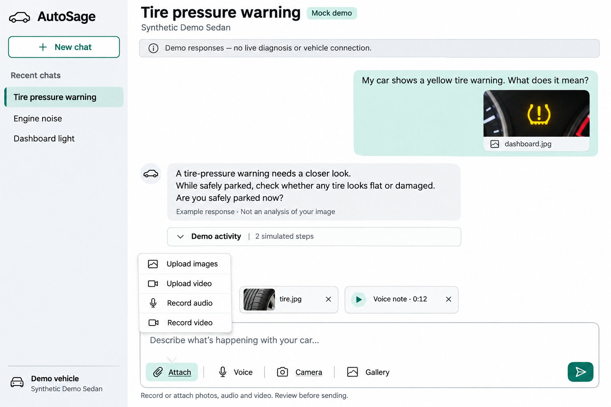
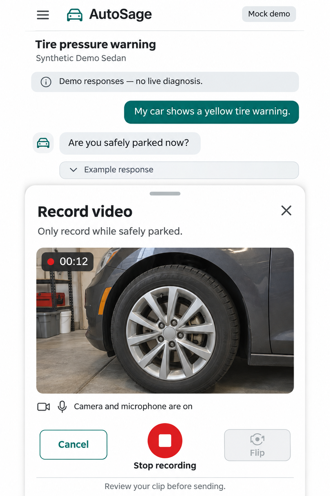

# AutoSage Multimodal Chat UI

## Summary

Build a React + TypeScript frontend and FastAPI mock backend using the approved white-and-teal designs.

Users can send text, record audio, record camera video, and upload gallery images/videos. Capture, uploads, and playback work; assistant replies are clearly labeled examples.

### Desktop chat mockup

### Mobile recording mockup

These are approved visual concepts generated with the built-in Image Gen tool, not screenshots of an implemented application. The desktop palette and component styles are the shared visual direction for both layouts.

## Implementation

- Use Vite, React, TypeScript, Tailwind, and outline icons. Separate the chat shell, message list, composer, attachment previews, recorder, and API client.
- Desktop includes recent conversations and a centered chat workspace. Mobile uses a navigation drawer, fixed composer, and recording bottom sheet.
- Support multiline text, attachment-only messages, removable draft attachments, image previews, and native audio/video playback.
- Voice opens audio recording. Camera opens video preview with start, stop, cancel, and review controls. Users explicitly attach the reviewed recording before sending.
- Stop microphone/camera tracks when recording ends or the dialog closes. Release preview URLs when attachments are removed.
- Select supported recording formats at runtime using `MediaRecorder.isTypeSupported()`. Show clear permission/device errors and retain upload options. Recording requires localhost or HTTPS. See [browser media documentation](https://developer.mozilla.org/en-US/docs/Web/API/MediaDevices/getUserMedia).
- Include empty, recording, review, sending, failed-send, and populated chat states. Preserve drafts after failures; prevent duplicate sends while a request is pending.
- Match the approved desktop palette and component styles across mobile. Provide keyboard navigation, visible focus, accessible dialog behavior, and labeled controls.

## FastAPI and Mock Behavior

- Provide `GET /api/health`, `GET /api/vehicles`, `GET/POST /api/incidents`, and `GET /api/incidents/{id}`.
- Accept text and repeated attachment files through multipart `POST /api/incidents/{id}/messages`. Return the saved user message, example assistant reply, and explicitly simulated activity. See [FastAPI multipart documentation](https://fastapi.tiangolo.com/tutorial/request-forms-and-files/).
- Provide `GET /api/attachments/{id}` for previews and playback.
- Share typed message and attachment contracts: ID, role, text, timestamp, media kind, filename, MIME type, size, and media URL.
- Use deterministic tire-warning, engine-noise, brake-warning, and generic replies. Media-only submissions acknowledge receipt without claiming analysis or transcription.
- Keep a persistent "Mock demo" disclosure. The brake-warning example displays prominent stop-driving guidance; simulated activity never claims tools actually ran.

## Validation and Defaults

- Test text-only, attachment-only, mixed-media, multiple attachments, recording cancellation/review, playback, conversation switching, permission denial, unsupported recording, backend errors, and upload limits.
- Verify actual microphone/camera capture manually; use simulated device streams for repeatable browser tests.
- Run frontend type/build checks, focused backend tests, and desktop/mobile browser checks. Compare rendered screens against both approved mockups.
- Default limits: five attachments per message, 25 MB per file, 50 MB total; audio recording up to two minutes and video up to one minute. Enforce upload limits server-side.
- Store conversations and media temporarily in backend memory; restarting clears them. Use one backend worker for this local demo.
- This phase excludes live Gemini integration, transcription, persistent storage, authentication, deployment, and the broader diagnostic workflow. Document local startup and these boundaries in the README.

## Relationship to the Project Plan

This plan records the explicitly selected chat UI and mock API phase. The broader AutoSage specification in `../PROJECT_PLAN.md` describes a future real-agent diagnostic workflow; it is not implemented or superseded by these mockups. No application code is included in this design handoff.

## Implementation Status

The mock UI phase is now implemented in `../frontend` and `../backend`. See [local setup and limitations](../README.md). The production frontend build, seven backend tests, and three Chromium end-to-end scenarios pass, including synthetic-device audio/video recording and playback. Real physical-device and cross-browser testing remain manual checks.

The implementation uses the desktop palette consistently on mobile. Initial demo chats contain text only; real attachments render after upload. A fifth attachment menu action, Upload audio, makes file upload available when microphone permission is denied. Recording previews show the actual camera stream rather than the illustrative wheel photo in the mockup.

## Live Gemini Phase

The current application supersedes the mock API behavior described above with real Gemini investigations. See [README.md](../README.md) for setup, contracts and limitations. The approved layout and capture controls remain; live provider status, confirmed vehicle details, grounded citations, actual tool events and retryable background processing replace demo content. There are no seeded conversations or production canned-reply fallbacks.

The selected default is `gemini-4-carbon`, following the user's request for the best available reasoning model; `GEMINI_MODEL` remains configurable. The root `.env` holds the backend-only AI Studio key. Google Search and URL context provide external evidence; vehicle-profile and mechanic-report functions run locally with validated arguments. Sensor calls, synthetic telemetry, Bayesian rankings and offline Gemma remain deferred.
